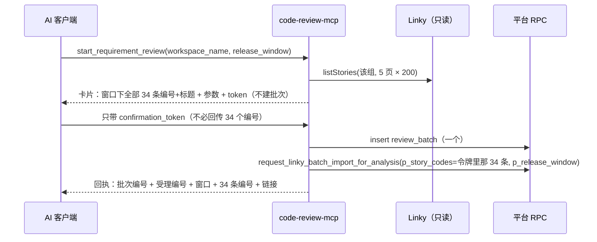

# 需求开发评审一致性平台 V1.68：MCP 按发布窗口批量评审最终执行方案

## 1. 背景与目标

V1.66 让 MCP 一次能提交多条需求（`story_codes`），V1.67 让 `search_requirements` 能按
发布窗口查。但"评审工具开发组 R20261106 窗口的全部需求"仍然要两步人工接力：先查出 34 个
编号，再把 34 个编号抄进 `story_codes`。编号抄漏一个没有任何地方会发现 —— 回执里写的是
提交了多少条，不是"那个窗口有多少条"。

V1.67 的方案里把"提交工具收发布窗口"写成了非目标，理由是**按一个筛选条件批量花钱、而
使用者从没逐条看过编号**。这一版实现它，但那条理由没有被推翻，而是换了方式满足：
提交仍然是两步的，第一次调用把那个窗口的**全部编号与标题逐条列在确认卡片上**，
使用者看过之后才可能提交；而且令牌绑定的是**那一刻枚举出来的编号集合**，不是窗口这个条件。

目标：`start_requirement_review` 支持 `release_window`——给项目组 + 发布窗口，平台自己
枚举该窗口下的全部需求，列出来让使用者确认，确认后一次落成一个批次。

## 2. 范围与非目标

本次包含（全部在 `mcp/code-review-mcp/`）：

- `start_requirement_review` 新增 `release_window`（与 `story_code`/`story_codes` 互斥），
  按窗口提交时 `workspace_name` 必填；
- 枚举走上游需求列表（与平台导入页同一个数据来源），不逐条打开需求详情；
- 确认卡片逐条列出编号、标题、状态、负责人、迭代，并写明"条数就是额度条数"；
- 令牌绑定枚举出来的编号集合 + 窗口；第二次调用不再重新枚举；
- 窗口模式上限 50 条（与按编号提交的 20 条不同，理由见 §5）；
- 导入单落 `release_window`（平台页面上的那次选择本来就记在这一列）。

明确不包含：

- **不改数据库、RPC、Worker、能力契约、前端。** `request_linky_batch_import` 的
  `p_release_window` 参数一直在，只是 MCP 以前传 null。
- **不做"跨项目组按窗口提交"**：一张导入单只有一个项目组。
- **不在第二次调用时重新枚举窗口。** Linky 是实时的，两次调用之间窗口里可能多出一条需求；
  重新枚举等于提交一份没人确认过的集合。
- **不提供进度/结果查询**（一如既往）。

## 3. 当前实现与问题

```text
现在要评审一个窗口：
  search_requirements(workspace_name, release_window)   → 模型读到 34 条
  → 模型/使用者把 34 个编号抄进 story_codes
  → start_requirement_review(story_codes=[...34 条])
```

两个具体缺陷：

1. **抄漏不可见。** 34 条里抄了 31 条，回执说"3 条需求"那是对的——它不知道窗口里有 34 条。
   平台这一侧没有任何地方能发现差额。
2. **`story_codes` 上限 20 条挡住了真实窗口。** 实测最大的组（工具开发组）275 条需求分布在
   约 8 个窗口上，单个窗口 30 条上下，本来就超过 20。而那个 20 的来历是**按编号提交时逐条
   打开需求详情**的耗时（命中 5.84 秒、未命中 31.8 秒），和按窗口枚举完全不是一回事。

## 4. 需求与验收标准

| 编号 | 要求 | 验证方式 |
|---|---|---|
| A1 | 给 `workspace_name` + `release_window` 即可提交该窗口全部需求，无需自己给编号 | 单测 |
| A2 | 第一次调用**不建批次**，卡片逐条列出全部编号与标题，并写明条数 | 单测 |
| A3 | 令牌绑定枚举出的编号集合与窗口；第二次调用不重新枚举，落库用令牌里的集合 | 单测断言 RPC 实参与上游调用次数 |
| A4 | 第二次调用可以只带令牌（不必回传 34 个编号）；回传了则按集合核对 | 单测 |
| A5 | 窗口不存在时拒绝，并列出该组实际有哪些窗口、各多少条 | 单测 |
| A6 | 窗口内需求超过 50 条时拒绝，告知真实条数并指向平台页面 | 单测 |
| A7 | `release_window` 与 `story_code(s)` 同时给时拒绝（意图不明，不猜） | 单测 |
| A8 | 按窗口提交时缺 `workspace_name` 则拒绝（枚举必须有范围） | 单测 |
| A9 | Linky 取不到数时拒绝按窗口提交（枚举不出来就没有可提交的东西），不降级成"未核对照常提交" | 单测 |
| A10 | 导入单带上 `release_window`；回执写明窗口与条数 | 单测断言 `p_release_window` |
| A11 | 卡片与回执明确写出"字段来自需求列表，没有逐条打开详情"，不假装核对过正文与附件 | 单测 |
| A12 | 按编号提交（V1.66）的行为与文案逐字不变 | 既有 177 条用例全绿 |

边界与失败行为：

- 窗口值不做格式校验（`R20261106` 只是当前写法），只做精确匹配（忽略首尾空白与大小写）；
- 枚举翻 5 页 × 200 条（沿用 V1.67 的 `SEARCH_MAX_PAGES`）。没翻完整组时**拒绝**按窗口
  提交：此时"这个窗口有 N 条"这句话本身不可信，而它正是使用者要确认的东西；
- 窗口里只有 1 条时也允许提交（不是错误，只是回执用单条形态）。

## 5. 总体设计



**为什么窗口模式的上限是 50 而不是 20。** 两种模式的成本结构不同：

| | 按编号提交（V1.66） | 按窗口提交（本版） |
|---|---|---|
| 核对方式 | 逐条打开需求详情（命中 5.84s / 未命中 31.8s） | 整组列表 1~5 次请求（每次约 1.05s） |
| 耗时随条数 | 线性增长，20 条已接近客户端超时 | 与条数无关 |
| 能拿到的字段 | 含正文字数、附件数、三类负责人 | 列表字段（标题/状态/负责人/迭代/窗口） |
| "编号是否存在" | 靠详情端点反查 | **更强**：需求就是从该组列表里枚举出来的，而 Worker 导入时要求的恰好是"出现在该组列表里" |

所以窗口模式的限制不再是耗时，而是**人能不能看完**那张卡片和**一次花多少额度**。
50 条覆盖了实测最大组的单个窗口（约 30 条），卡片约 100 行仍可读；再大就该用平台页面的
「原始需求导入」——那里是勾选式的，逐条可见。

**为什么令牌绑定枚举结果而不是窗口条件。** Linky 是实时的。两次调用之间窗口里可能多出
一条需求，而那一条没人确认过。绑定集合意味着"确认的是什么，提交的就是什么"；
代价是如果使用者确实想带上新增的那条，得重新查一次、重新确认 —— 这正是应该发生的事。

## 6. 数据与接口设计

- 数据库 / RPC：**不涉及**。`p_release_window` 参数一直存在，Worker 不用它过滤
  （`batch-import-runner` 逐条在 `byCode` 里查，窗口只作为需求自身窗口为空时的兜底），
  落它是为了让导入单如实记录"这次导的是哪个窗口"，与页面行为一致。
- 工具入参（`start_requirement_review`）：

| 参数 | 变化 |
|---|---|
| `release_window` | **新增**，string ≤64，可选。与 `story_code`/`story_codes` 互斥 |
| `workspace_name` | 给了 `release_window` 时**必填**（枚举需要范围） |
| 其余 | 不变 |

- 确认令牌：规范串新增 `window=`；`verify` 在调用方未回传编号时跳过编号比对
  （提交用的是令牌里的集合，签名已保证它没被改过）。
- 回执新增 `release_window` 与"核对方式"一行。
- 配置：新增常量 `MAX_STORIES_PER_WINDOW = 50`（不设环境变量）。

## 7. 前端与 Worker/运行时改造

**均不涉及。** Worker 侧逻辑完全不变：它拿到的仍然是一张带 `story_codes` 的导入单。
能力契约与 manifest 哈希不变，新旧 Worker 可混跑。

## 8. 安全、兼容与回滚

- 额度：一次提交 N 条需求就是 N 条需求的额度。卡片第一行写明条数，确认文案也写明
  "这次是 N 条需求的量"。
- 权限：仍只用 anon key + 平台账号 JWT，RLS 照常生效。
- 兼容：`release_window` 可选，按编号提交的行为与文案逐字不变。**令牌规范串变化**，
  改造前签出的令牌会以 `CONFIRMATION_INVALID` 被拒并提示重新确认（进程重启本来就失效）。
- 回滚：MCP 独立容器，回滚上一版镜像；无数据变更需要回退。

## 9. 实施步骤与文件范围

1. `src/config.mjs`：`MAX_STORIES_PER_WINDOW`；
2. `src/preflight.mjs`：`PREFLIGHT_LISTED` 与 `preflightReleaseWindow`（枚举 + 窗口分布 + 失败分类）；
3. `src/confirm.mjs`：claim 带 `release_window`，规范串加 `window=`，未回传编号时跳过比对；
4. `src/format.mjs`：窗口形态的确认卡片、拒绝文本（带窗口分布）、回执增项；
5. `src/review.mjs`：`p_release_window` 透传与回执字段；
6. `src/tools.mjs`：schema 与描述、`handleSubmit` 的窗口分支与互斥校验；
7. 测试：新增 `test/release-window-submit.test.mjs`；
8. 文档：两份 README、`src/lib/product-version.ts`。

## 10. 验证结果

实际落地范围：

| 文件 | 改动 |
|---|---|
| `mcp/code-review-mcp/src/config.mjs` | `MAX_STORIES_PER_WINDOW = 50` |
| `mcp/code-review-mcp/src/preflight.mjs` | `PREFLIGHT_LISTED`、`preflightReleaseWindow`（枚举 + 窗口分布 + 四种拒绝） |
| `mcp/code-review-mcp/src/confirm.mjs` | claim 带 `release_window`，规范串 `window=`，未回传编号/窗口时跳过比对 |
| `mcp/code-review-mcp/src/format.mjs` | 卡片 `listedOnly` 形态与来源说明、拒绝文本带窗口分布、回执增窗口与"核对方式" |
| `mcp/code-review-mcp/src/review.mjs` | `buildBatchName` 的窗口形态、`p_release_window` 透传、回执字段 |
| `mcp/code-review-mcp/src/tools.mjs` | `release_window` 入参与描述、窗口分支编排、互斥与超限拒绝、日志 `mode` |
| `mcp/code-review-mcp/test/release-window-submit.test.mjs` | 新增 15 条用例 |
| `mcp/code-review-mcp/README.md`、根 `README.md` | 参数表与「评审一个发布窗口的全部需求」小节 |
| `src/lib/product-version.ts` | `V1.68` |

与计划的一处偏差：规范串里原来的 `window=` 是**提交时间窗口**（天数），现在发布窗口占用了
`window=`，天数改成 `window_days=`。两个"窗口"在这个产品里是不同的东西（需求的发布窗口 /
代码的追溯天数），规范串里更不能混；卡片上也把两者都写了全称。

实际执行的验证：

| 命令 | 结果 |
|---|---|
| `npm test`（mcp，`node --test`） | **192 pass / 0 fail**（V1.67 的 177 + 本次 15） |
| 既有 177 条全绿 | A12（按编号提交行为不变）成立 |
| `npm run web:typecheck`（根） | 通过 |
| `npm run build`（根） | 通过（仅既有 chunk 体积告警） |
| `npm test`（根 vitest） | **1441 pass / 35 skipped / 0 fail** |
| `npm run version:check -- <本文件>` | 文档 V1.68 = 展示 V1.68，通过 |
| 真实起服务 + MCP 客户端 | `tools/list` 回 5 个工具，`start_requirement_review` 的参数含 `release_window` |
| 真实打印两步文本 | 卡片逐条列出窗口下 5 条需求（编号/标题/状态/负责人/迭代）、写明「该窗口下全部 5 条」「这次是 5 条需求的量」「只需要带 confirmation_token」「令牌锁定的是这一组而不是这个窗口」，且**不**出现正文字数/附件数/三类负责人；回执含「发布窗口：R20261106（…全部 5 条）」、批次名 `MCP 评审：R20261106 共 5 条需求`、核对方式说明 |

逐条对照验收标准：A1~A12 全部由单测覆盖。其中 A3 断言第二次调用后
`linky.calls.listStories.length === 1`（确认后不再枚举）且 `p_story_codes` 等于枚举集合；
A9 分别覆盖"没配 Linky / 取不到数 / 整组没翻完"三种拒绝；A11 用否定断言确认卡片里
没有 `需求正文：` / `附件：` / `开发负责人`。

未运行的验证（需要公司内网，由使用者在 Linux 发布后执行）：

- 真实窗口下的枚举条数与耗时（单测用按实测字段形状构造的假响应）；
- 真实超过 50 条的窗口（当前最大组单窗口约 30 条，构造不出真实场景）；
- 端到端跑完一次按窗口提交的分析（需要真实额度，建议先用 1 条需求的小窗口试）。
