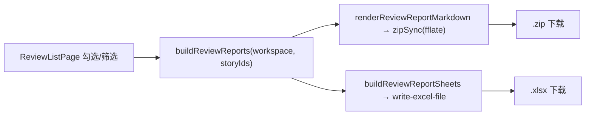

# 需求开发评审一致性平台 V1.69：评审报告批量下载最终执行方案

## 1. 背景与目标

评审结论目前只能在页面上一条一条看：`/batches/:id/reviews` 列出需求，点进去才看到验收点、
风险、代码证据与人工结论。要把结论发给开发、测试或留档，只能截图或人工抄录。

一个批次现在动辄 30 条需求（V1.68 起可以按发布窗口一次提交整窗），逐条抄录不现实。

目标：在评审列表页支持**勾选多条需求、一次下载评审报告**，两种形态：

- **Excel 汇总**（一份 `.xlsx`，5 个 Sheet）：便于按需求/验收点/风险/证据四个维度筛查与留档；
- **Markdown 逐条**（一个 `.zip`，每条需求一个 `.md` + 一份汇总）：便于直接发给某个开发看。

## 2. 范围与非目标

本次包含：

- 评审列表页加行勾选、范围说明与「下载评审报告」下拉按钮；
- 新模块 `src/lib/review-report.ts`：报告组装（纯函数）、Markdown 渲染、Excel sheet 构造、下载入口；
- 报告内含**出处**：批次名、发布周期、代码基线分支与基线 Commit、分析模型、分析完成时间、导出时间。

明确不包含：

- **不新增任何接口。** 列表页已经通过 `getBatchWorkspace` 把 stories / results / evidence /
  humanReviews 全量取到浏览器，报告完全从已加载数据组装 —— 不新增 RPC、不改数据库、不改 Worker。
- **不做服务端生成或邮件发送。**
- **不做 PDF**：中文 PDF 需要内嵌字体（上百 KB 的字体文件进包），而 Markdown 与 Excel 已经
  覆盖"发给人看"和"留档筛查"两种真实用途。
- **不加每行一个下载按钮**：表格已经 `scroll.x=1520`，再加一列会把需求名称挤掉；勾一行即可。

## 3. 当前实现与问题

```text
ReviewListPage（src/App.tsx）
  useBatchWorkspace(batchId) → { batch, activeImport, stories, results, evidence, humanReviews }
  → rows = stories 关联 result / 最新 humanReview / 证据条数
  → <Table columns dataSource={rows} />        ← 只能看，没有任何导出入口
```

缺口就一个：数据全在浏览器里，但没有出口。

另有一个和"范围"相关的坑必须处理：表格的列筛选由 antd 内部完成，组件自己并不知道
"当前筛选结果"是哪些行。如果下载按钮写成"下载全部"，在有筛选的情况下就会和用户眼前看到的
不一致 —— 这正是最容易让人拿错报告的地方。

## 4. 需求与验收标准

| 编号 | 要求 | 验证方式 |
|---|---|---|
| A1 | 勾选 N 条后可一次下载，Excel 为**一份**文件，含批次信息/需求评审/验收点/风险/代码证据 5 个 Sheet | 单测（sheet 结构） |
| A2 | 表头全选覆盖**当前筛选结果**而不是当前页（沿用 V1.20 已有的三态全选逻辑） | 既有 `story-selection` 单测 + 页面复用 |
| A3 | 没有勾选时，下载范围 = 当前筛选结果，且按钮文案必须写明是"已选 N 条"还是"当前筛选 N 条" | 单测（文案函数） |
| A4 | 报告包含出处：批次名、发布周期、基线分支、基线 Commit、模型、分析时间、导出时间 | 单测 |
| A5 | 未分析的需求如实写"未分析"，不留空、不编结论 | 单测 |
| A6 | 有结构化验收报告（`acceptance_review.version === 1`）时逐项导出验收点与风险；历史报告退回自由文本字段并标明是历史格式 | 单测（两种形态各一例） |
| A7 | Markdown ZIP 每条需求一个文件，文件名含编码；另有一份汇总；文件名里的非法字符被替换 | 单测 |
| A8 | 人工结论（含意见与确认时间）进报告；未确认的写"待确认" | 单测 |
| A9 | 下载不请求任何接口（纯浏览器组装） | 代码审查 + 单测不打桩网络 |
| A10 | 一条都没有可下载时按钮禁用，不生成空文件 | 单测（文案函数返回禁用态） |

边界与失败行为：

- 批次尚无 AI 导入记录（`activeImport === null`）时，批次信息里的模型/基线/分析时间写"未导入"，
  需求仍可导出（全部标未分析）；
- 需求名称含 `/ \ : * ? " < > |` 等文件名非法字符时替换为 `_`，并把长度截断到 60 字符；
- 证据按 `evidence_id || id` 关联到验收点与风险，关联不到的证据仍然出现在「代码证据」Sheet 里
  （它确实存在，只是没被某个验收点引用），不静默丢弃。

## 5. 总体设计



职责划分：

| 文件 | 职责 |
|---|---|
| `src/lib/review-report.ts` | 报告数据组装、Markdown 渲染、Sheet 构造、文件名、下载入口 |
| `src/App.tsx`（ReviewListPage） | 勾选状态、下载范围判定与按钮文案、调用下载 |
| `src/components/linky/story-selection.ts` | **复用**：`selectAllState` / `toggleSelectAllFiltered`（"全选当前筛选结果"的三态逻辑已在 V1.20 写好并测过） |

"当前筛选结果"的取法：antd `Table` 的 `onChange(_p, _f, _s, extra)` 会给出
`extra.currentDataSource`（筛选后、分页前）。只在**确实有筛选生效**时采用它派生的 id 集合，
没有筛选时直接用 `rows` —— 这样数据刷新后新增的需求不会被一份过期的 id 集合挡在范围外。

## 6. 数据与接口设计

- 数据库 / RPC / Edge Function / Worker：**均不涉及**。
- 依赖：`write-excel-file`（已有，AI 模板下载在用）、`fflate`（已有，技能包预览在用）。不新增依赖。
- 新增导出函数（`src/lib/review-report.ts`）：

| 函数 | 作用 |
|---|---|
| `buildReviewReports(input)` | 把 workspace 数据 + 选中 id 组装成 `ReviewReport[]`（纯函数） |
| `buildReportMeta(batch, activeImport, scope)` | 出处信息（纯函数） |
| `renderReviewReportMarkdown(report, meta)` | 单条需求的 Markdown（纯函数） |
| `renderReviewSummaryMarkdown(reports, meta)` | 汇总 Markdown（纯函数） |
| `buildReviewReportSheets(reports, meta)` | 5 个 Sheet 的二维数组（纯函数） |
| `reportScopeLabel(selected, filtered, total)` | 按钮文案与禁用态（纯函数） |
| `downloadReviewReportsXlsx` / `downloadReviewReportsZip` | 唯一两个有副作用的函数 |

## 7. 前端与 Worker/运行时改造

前端：评审列表页上方新增一行工具条（范围说明 + 下载下拉按钮），表格新增勾选列。
Worker / DSH / 权限 / 预算 / Session：**不涉及**。

## 8. 安全、兼容与回滚

- **不绕过权限**：下载的是浏览器已经通过 RLS 取到的数据，没有新的读通道；没有权限的人连列表都看不到。
- **不执行模型输出**：Markdown 只是文本拼接，不渲染、不执行；Excel 单元格按字符串写入。
  长文本只做换行归一，不做 HTML 处理。
- 兼容：纯新增 UI 与新模块，历史批次（无结构化验收报告）走自由文本分支。
- 回滚：纯前端，回滚上一版静态资源即可；没有数据变更。

## 9. 实施步骤与文件范围

1. `src/lib/review-report.ts`：类型 + 纯函数 + 两个下载入口；
2. `src/App.tsx`：ReviewListPage 勾选、范围判定、工具条与下载按钮；
3. `src/App.css`：工具条样式（沿用既有 token，不引新色）；
4. `src/lib/__tests__/review-report.test.ts`：覆盖 A1~A10 的纯逻辑部分；
5. 文档：根 `README.md`、`src/lib/product-version.ts`。

## 10. 验证结果

实际落地范围：

| 文件 | 改动 |
|---|---|
| `src/lib/review-report.ts` | 新增：报告组装、范围文案、文件名净化、Markdown 渲染、5 个 Sheet 构造、两个下载入口 |
| `src/App.tsx`（ReviewListPage） | 下载工具条、行勾选（复用 `selectAllState`/`toggleSelectAllFiltered`）、**筛选改为页面侧自算**、受控分页 |
| `src/App.css` | `.review-list-toolbar` 样式（沿用 `.story-action-bar` 的同一组 token） |
| `src/lib/__tests__/review-report.test.ts` | 新增 22 条用例 |
| `README.md`、`src/lib/product-version.ts` | 文档与版本 |

与计划的一处偏差（更正了一个会直接导致范围错的实现）：原计划用 antd `onChange` 的
`extra.currentDataSource` 取"当前筛选结果"。实现时发现它只在**用户动过表格之后**才有 ——
而从统计看板下钻进来（URL 带 `?verdict=PARTIAL`）时一次都没动过，那一刻按钮上的条数会是
全部条数，正是本方案要避免的那种错。改成在页面侧用同一组谓词算出 `filteredRows`，
去掉各列的 `onFilter`（antd 受控筛选的标准用法），`dataSource` 直接给筛选后的数据。
副作用是分页要自己管：筛选事件里显式回第 1 页，并在渲染期夹取页码，
否则停在第 3 页时筛出 5 条会得到一张空表。谓词因此只存在**一处**，不再和列定义重复。

实际执行的验证：

| 命令 | 结果 |
|---|---|
| `npx vitest run -c vitest.web.config.ts src/lib/__tests__/review-report.test.ts` | **22 pass / 0 fail** |
| `npm test`（根 vitest 全量） | **1463 pass / 35 skipped / 0 fail**（V1.68 的 1441 + 本次 22） |
| `npm run web:typecheck` / `npx tsc -p tsconfig.app.json --noEmit` | 均通过 |
| `npm run build` | 通过 |
| `npm run lint` | 0 errors（仅既有 19 条告警，未新增） |
| 真实渲染一份 Markdown 报告（tsx 跑真实模块） | 出处 7 行齐全；验收点 AC-1/AC-2 逐项含结论与理由；AC-2 的独立复核分歧写明"调查判定 未实现 / 复核判定 无法判断"；风险含确定性/归因/触发/影响/关联验收点/复核备注；证据含仓库、路径、48-72 行、commit；人工结论含意见与确认时间 |

逐条对照验收标准：A1（5 个 Sheet 顺序）、A3（三种范围文案 + 禁用态）、A4（出处 + 未导入兜底）、
A5（未分析/待确认/无证据）、A6（结构化与历史两种形态各一例，历史格式明确标注）、A7（文件名净化
与长度截断）、A8（取最后一次人工确认）、A10（0 条时禁用）均有断言；A2 复用 V1.20 已测过的
三态全选逻辑；A9 由测试不打桩任何网络、模块不 import `api.ts` 保证。

未运行的验证：

- 浏览器里实际点击下载（`writeXlsxFile(...).toFile()` 与 `URL.createObjectURL` 都需要真实
  浏览器环境，node 下跑不了）—— 需要在页面上点一次确认两个文件能正常打开；
- 几十条需求的大报告体积与生成耗时（ZIP 用 `fflate.zipSync` 同步压缩，50 条纯文本预计
  在百毫秒级，未实测）。
