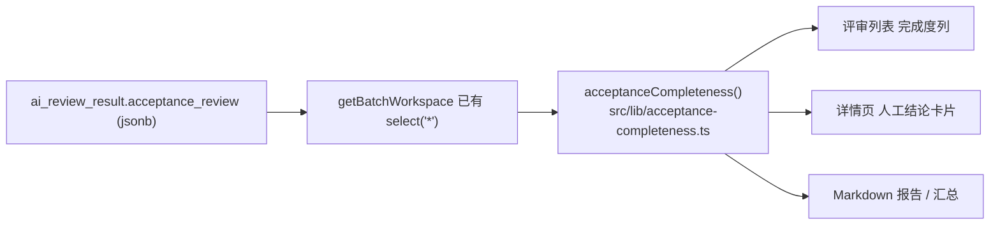

# 需求开发评审一致性平台 V1.71：验收点完成度最终执行方案

## 1. 背景与目标

### 1.1 现场观察

V1.43 的「验收点评审工作流」上线后，评审列表的「AI判断」列几乎每一行都是**无法判断**，而点进详情页能看到「共 11 个验收点：已实现 7，部分实现 0，未实现 0，不确定 4」—— 大部分验收点其实是通过的。

原因在 `worker/src/ai/review-workflow.ts:186-191` 的 `overallVerdict()`：

```ts
if (!findings.length || findings.some((finding) => finding.verdict === 'UNCERTAIN')) return 'UNCERTAIN'
```

需求级 `verdict` 是从验收点结论**派生**的，而派生规则是"一票否决"：11 个验收点里只要有 1 个 `UNCERTAIN`，整条需求就是无法判断。叠加 `review-workflow.ts:150-158`（调查与独立复核分歧的验收点被强制改成 `UNCERTAIN`），绝大多数需求都会命中这一条。

结果是列表页把"7/11 已实现"和"0/11 已实现"显示成同一个标签。列表作为评审入口，失去了排序和分流的能力。

### 1.2 「置信度 未填写」的原因

同一次改造的直接产物，不是回归：

- `worker/src/index.ts:515`：`confidence: submission.acceptanceReview ? null : submission.confidence` —— 只要本次提交带了结构化验收报告，整体置信度就被显式写成 `null`。
- `worker/src/ai/review-workflow.ts:193-195`：平台自己合成终局提交时 `confidence: 0` 只是占位，随后在上一行被覆盖成 `null`。
- `worker/src/harness-plugins/review-control-tool/index.ts:242-245`：工作流模式下 `confidence` 不再是必填参数。
- `worker/src/ai/prompts/acceptance-review.ts`：三阶段提示词通篇不提置信度，模型根本不被要求产出它。
- `supabase/migrations/20261004182525_acceptance_review_workflow.sql:5-6`：`analysis_job.review_workflow_version` 默认值改为 1，所有新批次都走工作流模式。

所以**新批次的 `ai_review_result.confidence` 一律是 NULL**，前端 `src/App.tsx:4012` 的 `confidence === null ? '未填写'` 如实显示。只有 V1.43 之前的历史批次才有数值。

设计意图是合理的：整体置信度是模型对自己的一句自我评价，而工作流版本已经有了逐验收点结论 + 独立复核 + 分歧标记这些可核查的事实。本版本**不重新引入模型自评置信度**，而是用可以从验收点结论算出来的「完成度」占据这个展示位。

### 1.3 目标

1. 评审列表用「完成度」百分比替代「AI判断」，让"做了多少"可比、可排序、可筛选。
2. 详情页「人工结论」卡片顶部用「完成度」替代「AI 原判断 + 置信度」；历史批次没有验收点结论，继续显示原来的 AI 判断与置信度。
3. 评审报告（Markdown）输出同一口径的完成度。
4. 三处共用同一个计算函数，不允许出现"列表 73%、详情 70%"。

## 2. 范围与非目标

### 2.1 本次包含

- 新增 `src/lib/acceptance-completeness.ts`：完成度的唯一计算口径（权重表 `COMPLETENESS_WEIGHTS`、百分比与上限、分类计数、区间、配色、说明文案）。
- `src/App.tsx` 评审列表：「AI判断」列换成「完成度」列（进度条 + 百分比 + 验收点数），支持按完成度排序、按完成度区间筛选。
- `src/App.tsx` 评审列表工具条：当 URL 带 `?verdict=` 时显示一个可关闭的筛选提示标签（列头不再提供 AI 判断下拉，看板下钻过来必须有可见线索）。
- `src/App.tsx` 详情页 `HumanReviewPanel`：有结构化验收报告时显示完成度，否则保持 AI 判断 + 置信度。
- `src/lib/review-report.ts`：单条报告增加「完成度」行；汇总表把「置信度」列换成「完成度」列，并在结论分布里增加平均完成度。
- `src/App.css`：完成度单元格样式。
- 测试：新增 `src/lib/__tests__/acceptance-completeness.test.ts`，更新 `src/lib/__tests__/review-report.test.ts`。

### 2.2 明确不包含

- **不改 Worker**：不恢复模型自评置信度，不改 `overallVerdict()`，不改提示词，不改 `toAgentResultRow()`。需求级 `verdict` 继续按原规则派生并原样入库，只是列表不再把它当主展示。
- **不改数据库**：完成度全部从已有的 `ai_review_result.acceptance_review` jsonb 在浏览器端派生。`getBatchWorkspace`（`src/lib/api.ts:659-694`）本来就是 `select('*')`，这列数据已经在浏览器里，不新增查询、不新增 RPC、不新增迁移、不新增权限面。
- **不改统计看板**：「AI 判断分布」卡片及其下钻链接 `?verdict=XXX` 保持原状，列表侧的 `verdict` 过滤逻辑原样保留，下钻不失效。看板的验收点维度统计留给后续版本。
- **不改 Excel 人工导入链路**（`src/lib/excel.ts`、`src/lib/prompt.ts`）：那条链路的「AI判断」「置信度」是人工填写的模板列，与本次展示口径无关。

## 3. 当前实现与问题

| 位置 | 现状 | 问题 |
| --- | --- | --- |
| `src/App.tsx:3753-3766` | 「AI判断」列渲染 `row.result.verdict` | 一票否决导致几乎全是「无法判断」 |
| `src/App.tsx:4006-4014` | 「AI 原判断」+「置信度」 | verdict 信息量低；confidence 必为 NULL → 「未填写」 |
| `src/lib/review-report.ts:282-284` | 报告输出「总体判断」「置信度」 | 置信度恒为空；没有完成度 |
| 全仓库 | 无任何按验收点结论的加权统计 | 需要新建 |

数据侧已经具备的事实（`worker/src/ai/review-workflow-types.ts`）：

- `acceptance_review.criteria[]`：固定验收点清单，`id` 为 `C1`/`AC-1` 之类。
- `acceptance_review.findings[]`：每个验收点一条 `{ criterionId, verdict, reason, evidenceIds }`，`verdict` 取值 `IMPLEMENTED | PARTIAL | NOT_IMPLEMENTED | UNCERTAIN`。
- `acceptance_review.version`：只有 `1` 是当前结构，历史批次该列为 NULL。

## 4. 需求与验收标准

| 编号 | 验收标准 |
| --- | --- |
| AC-1 | 完成度 = Σ(验收点权重) / 验收点总数，权重：已实现 1、部分实现 0.6、未实现 0、不确定 0.25；结果四舍五入为 0–100 整数 |
| AC-1b | 「不确定」与「未实现」权重必须不同：未实现是查清了没做（0 分），不确定是还没查清（0.25 分）。因此 0% 只在全部未实现时出现 |
| AC-1c | 上限（`potentialPercent`）按"把每个不确定项从当前权重补到满分"计算，随权重表自动变化，不得写死为"加 1 分" |
| AC-2 | 分母取 `criteria.length`；`findings` 里缺这个验收点的结论时，该点按「不确定」计入，分母不缩小 |
| AC-3 | `criteria` 为空但 `findings` 非空时，用 `findings` 作为基准；两者都为空或 `version !== 1` 时返回 null（无完成度数据） |
| AC-4 | 列表「完成度」列显示百分比 + 进度条 + `N 项`；有不确定验收点时追加「待确认 n」 |
| AC-5 | 没有 AI 结果显示「未分析」；有 AI 结果但没有 v1 验收报告（历史批次）显示「历史报告」 |
| AC-6 | 列表完成度列可排序；无完成度数据的行排在最后 |
| AC-7 | 列表完成度列可按区间筛选：100%、60–99%、1–59%、0%、无完成度数据 |
| AC-8 | 看板「AI 判断分布」下钻（`?verdict=IMPLEMENTED` 等）仍然正确过滤，且工具条显示可关闭的「AI判断：已实现」标签 |
| AC-9 | 详情页有 v1 验收报告时显示「完成度 x%」与验收点计数；历史批次保持「AI 原判断 + 置信度」 |
| AC-10 | 完成度 Tooltip 说明四类计数，并在有不确定项时说明"若全部确认为已实现，完成度可达 y%" |
| AC-11 | 单条 Markdown 报告含「完成度：x%（已实现 a / 部分实现 b / 未实现 c / 不确定 d）」；汇总表「完成度」列替代「置信度」列；结论分布含平均完成度 |
| AC-12 | 列表、详情、报告三处百分比完全一致（同一函数） |

边界与失败行为：

- jsonb 里出现未知 `verdict` 字符串时按「不确定」计入，不抛错、不产生 `NaN`。
- 完成度只是派生展示值，不落库、不参与批次完成门禁、不影响人工结论保存。

## 5. 总体设计



单一计算入口，三处消费。不新增数据通道，不新增后端聚合。

## 6. 数据与接口设计

- 数据库：**不涉及**（无迁移、无 RPC、无 RLS、无 Storage 变更）。
- Edge Function：**不涉及**。
- 新增前端模块 `src/lib/acceptance-completeness.ts` 导出：

```ts
export const COMPLETENESS_WEIGHTS: Record<ReviewVerdict, number>
export interface AcceptanceCompleteness {
  percent: number                            // 0–100 整数
  potentialPercent: number                   // 不确定项全部按已实现算的上限
  total: number                              // 验收点总数（分母）
  counts: Record<ReviewVerdict, number>
}
export function acceptanceCompletenessOf(report): AcceptanceCompleteness | null
export function acceptanceCompleteness(result): AcceptanceCompleteness | null
export function completenessTooltip(value): string
export function completenessBreakdown(value): string
export function completenessTagColor(percent): 'green' | 'orange' | 'red'
export function completenessTone(percent): string                 // 进度条 hex
export type CompletenessBand = 'FULL' | 'HIGH' | 'LOW' | 'ZERO' | 'NONE'
export function completenessBand(percent): CompletenessBand
export const completenessBandOptions: Array<{ value: CompletenessBand; label: string }>
```

- 类型变化：`src/App.tsx` 的 `localColumnFilters` 增加 `completeness` 键；列表行派生对象增加 `completeness` 字段。

## 7. 前端与 Worker/运行时改造

### 7.1 评审列表（`src/App.tsx` `ReviewListPage`）

- `rows` useMemo 增加 `completeness: acceptanceCompleteness(result)`。
- 「AI判断」列替换为「完成度」列：`sorter` 按 percent 降序（null 视为 -1 垫底）、`filters` 为完成度区间、`render` 为 `CompletenessCell`。
- `filteredRows` 的 `matches()` 增加完成度区间判断；`verdict` 的 URL 过滤分支原样保留。
- Table `onChange` 把 `filters.completeness` 并入 `localColumnFilters`，并从 `updateFilters` 的入参里去掉 `verdict`（列头已无此下拉）。
- 工具条在 `verdict` 存在时渲染可关闭标签，关闭即 `updateFilters({ verdict: undefined })`。

### 7.2 详情页（`src/App.tsx` `HumanReviewPanel`）

`review-decision-context` 内按是否有完成度二分：有则「完成度 + Tag + 验收点计数」，无则保留「AI 原判断 + 置信度」。右侧对齐槽位改放「上次保存」。

### 7.3 报告（`src/lib/review-report.ts`）

- `renderReviewReportMarkdown`：`## AI 评审结论` 段落在有验收报告时输出完成度行，否则输出置信度行；「总体判断」保留。
- `renderReviewSummaryMarkdown`：表头改为 `| 编码 | 需求名称 | 完成度 | AI 判断 | 证据 | 人工结论 |`；结论分布增加平均完成度。

### 7.4 Worker / DSH / 运行时

**不涉及**。本次不触碰 `worker/**`、`Dockerfile.worker`、`docker-compose.worker.yml`，不需要重建镜像或重启 Worker。

## 8. 安全、兼容与回滚

- 权限：无新增读写通道，RLS 不变。完成度是浏览器端对已授权数据的再计算。
- 秘密：不涉及。
- 旧数据：历史批次 `acceptance_review` 为 NULL，列表显示「历史报告」，详情页与报告回落到原来的 AI 判断 + 置信度展示，信息不丢。
- 在途任务：不涉及 Worker 与数据库，正在跑的分析任务不受影响，无需排空。
- 模型输出健壮性：未知 verdict 归入「不确定」，不会把页面算崩。
- 上线：前端构建产物发布即生效。
- 回滚：`git revert` 该前端提交并重新发布前端，数据库与 Worker 无需回滚。

## 9. 实施步骤与文件范围

1. 新增 `src/lib/acceptance-completeness.ts`。
2. 新增 `src/lib/__tests__/acceptance-completeness.test.ts`。
3. 改 `src/App.tsx`：列表列、行派生、筛选、排序、工具条标签、详情页卡片。
4. 改 `src/App.css`：完成度单元格样式。
5. 改 `src/lib/review-report.ts` 与 `src/lib/__tests__/review-report.test.ts`。
6. 改 `src/lib/product-version.ts` → `V1.71`。
7. 运行 `npm run version:check`、`npm run test:web`、`npm run web:typecheck`、`npm run lint`、`npm run build`。

## 10. 验证结果

本次实际落地与方案一致，以下为真实执行结果（2026-11-06）。

### 10.1 实际修改文件

| 文件 | 变更 |
| --- | --- |
| `src/lib/acceptance-completeness.ts` | 新增。权重表、`acceptanceCompletenessOf` / `acceptanceCompleteness`、`completenessTooltip` / `completenessBreakdown`、配色与区间、`averageCompleteness` |
| `src/lib/__tests__/acceptance-completeness.test.ts` | 新增，11 条用例 |
| `src/App.tsx` | 新增 `CompletenessCell`；`rows` 派生 `completeness`；「AI判断」列换成可排序可筛选的「完成度」列；`localColumnFilters` 增加 `completeness`；Table `onChange` 不再回写 `verdict`；工具条新增可关闭的 AI 判断筛选标签；`HumanReviewPanel` 顶部按有无验收报告二分展示；新增完成度相关 import |
| `src/App.css` | `.review-decision-confidence` 改名 `.review-decision-aside`；新增 `.completeness-metric*`、`.review-list-toolbar__filter` |
| `src/lib/review-report.ts` | 单条报告「完成度 / 置信度」二选一；汇总表「完成度」列替代「置信度」列；结论分布增加平均完成度 |
| `src/lib/__tests__/review-report.test.ts` | 更新完成度断言，新增汇总表完成度列用例 |
| `src/lib/product-version.ts` | `PRODUCT_VERSION` → `V1.71` |

未改动：`worker/**`、`supabase/**`、`Dockerfile.worker`、`docker-compose.worker.yml`、统计看板、`src/lib/excel.ts`、`src/lib/prompt.ts`。

### 10.2 关键实现决定

- **`onChange` 不再回写 `verdict`。** 列头去掉 AI 判断下拉后，`normalize(filters.verdict)` 恒为 `null`；若继续写回 `updateFilters`，用户从看板下钻过来只要动一下任意列筛选，就会把 URL 上的 `verdict` 抹掉。现在 `verdict` 只能由看板链接设置、由工具条标签关闭。
- **排序把无完成度的行当成 -1。** 升序时「未分析 / 历史报告」排最前、降序时排最后，不会混在 0% 中间。
- **列表「历史报告」与「未分析」分开。** 判据是 `row.result?.verdict` 是否存在：有 AI 结果但没有 v1 验收报告才是历史格式。
- **权重表是单一事实来源。** Tooltip 里的「已实现记 1 分、部分实现记 0.6 分…」与上限计算都从 `COMPLETENESS_WEIGHTS` 派生，不写死数字 —— 否则改了权重而文案没跟着改，页面会一边显示 73% 一边解释说"不确定按 0 分计入"。

### 10.3 执行的检查

| 命令 | 结果 |
| --- | --- |
| `npx vitest run -c vitest.web.config.ts src/lib/__tests__/acceptance-completeness.test.ts` | 通过，10/10 |
| `npm run test:web` | 通过，31 个文件 / 342 条用例（含 `review-report.test.ts` 18 条） |
| `npm run web:typecheck` | 通过，无错误 |
| `npx oxlint src/lib/acceptance-completeness.ts src/lib/review-report.ts src/lib/__tests__/acceptance-completeness.test.ts` | 0 warnings / 0 errors |
| `npm run lint` | 0 errors；19 条告警全部位于本次未改动的既有代码 |
| `npm run build` | 通过（3393 modules，CSS 121.64 kB / JS 2002.90 kB） |
| `npm run version:check -- "需求开发评审一致性平台/V1.71-验收点完成度/需求开发评审一致性平台-V1.71验收点完成度-最终执行方案.md"` | 文档版本 V1.71 == 管理员展示版本 V1.71 |

单元测试覆盖的验收标准：AC-1、AC-1b、AC-1c、AC-2、AC-3、AC-10、AC-11、AC-12（完成度口径、不确定与未实现区分、上限随权重表变化、缺结论兜底、未知 verdict 兜底、Tooltip 文案、报告输出、同源计算）。其中直接复现了现场那条需求：11 个验收点、已实现 7、不确定 4 → `(7×1 + 4×0.25) / 11 = 8/11` → **73%**，上限 100%，而需求级 verdict 仍是「无法判断」。

### 10.4 未运行的验证

AC-4 ~ AC-9 属于页面交互（完成度单元格渲染、排序、区间筛选、看板下钻标签、详情页二分展示），本次**未做浏览器实机烟测**，仅通过类型检查与构建保证可编译。建议发布前端后在 `crp-review.kingdee.com` 的 1106 批次上确认：列表完成度列、按完成度排序、区间筛选、从统计看板「AI 判断分布」下钻后工具条出现可关闭标签、详情页右栏显示「完成度 73% · 11 个验收点 · 待确认 4」。

